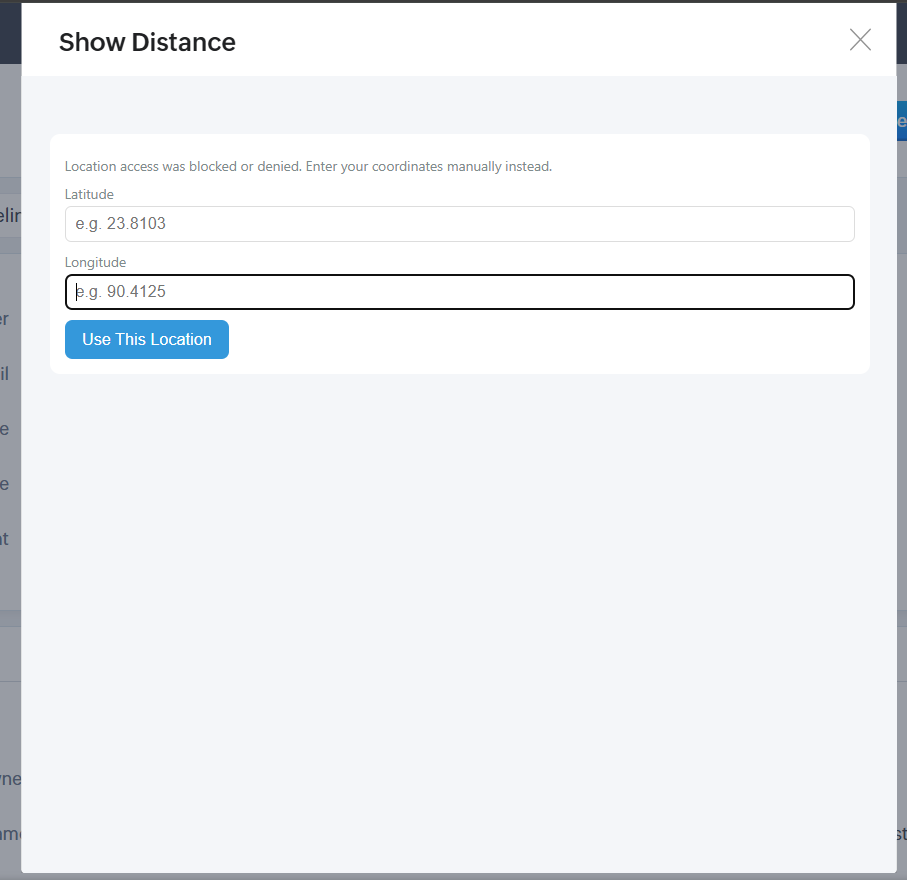
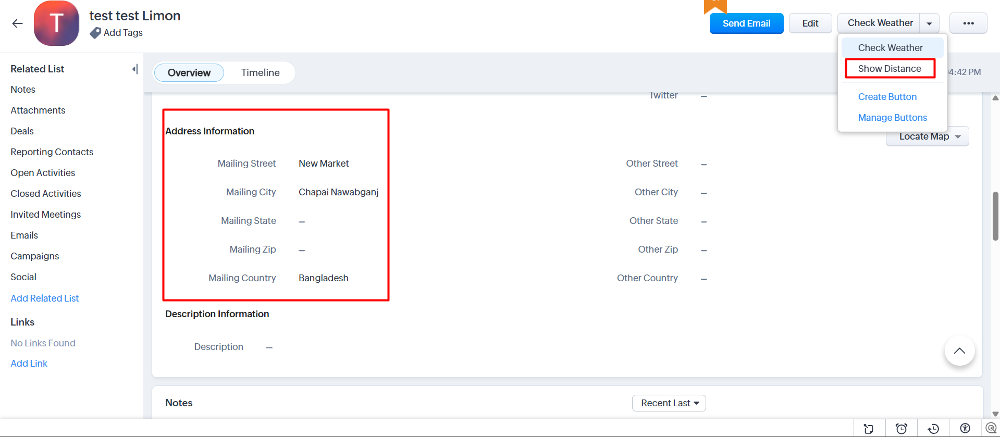
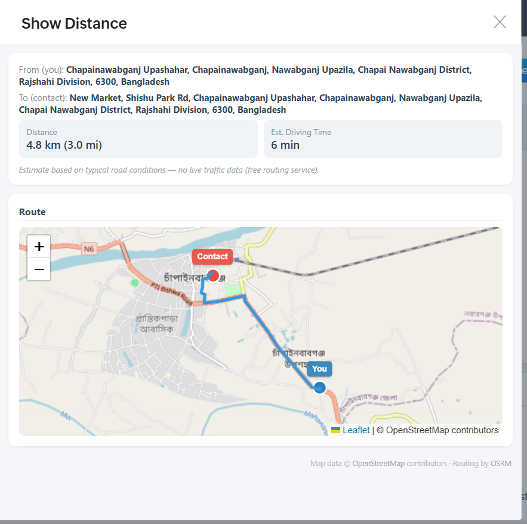

# Zoho CRM – Distance to Contact Widget

A Zoho CRM extension that shows how far a **Contact** is from your current
location — distance, estimated driving time, and a route drawn on a live map
— right inside the Contact's detail page.

Unlike typical "distance to address" tools, this one uses **only free,
keyless services**, so there's no billing account, no API key, and no quota
to manage:

- [**Nominatim**](https://nominatim.org/) (OpenStreetMap) for geocoding
- [**OSRM**](https://project-osrm.org/) public demo server for routing
- [**Leaflet**](https://leafletjs.com/) + OpenStreetMap tiles for the map itself

Built with:

- A **Deluge custom function** (`functions/get_distance_details_free.dg`)
  that geocodes the contact's mailing address, reverse-geocodes your
  browser location, and asks OSRM for a route between the two.
- A **Widget** (`app/widget.html`), embedded via the Zoho Embedded App SDK,
  that asks the browser for your location (with a manual lat/lng fallback)
  and renders the result on an interactive Leaflet map.


---

## ✅ About API keys — there aren't any

Unlike the companion weather widget in this account, this extension doesn't
call any paid or key-gated API. Nominatim and the public OSRM instance are
free to use without registration, subject to their fair-use rate limits
(see [Rate limits & fair use](#rate-limits--fair-use) below). Nothing needs
to be hidden or configured as a secret — clone it and it works.

---

## Repository structure

```
zoho-crm-contact-distance-extension/
├── app/
│   ├── widget.html                # The widget UI shown on the Contact page
│   ├── ZohoEmbededAppSDK.min.js   # Zoho's embedded app SDK (vendored)
│   └── translations/
│       └── en.json
├── functions/
│   └── get_distance_details_free.dg   # Deluge custom function
├── docs/                          # Screenshots / extra docs
├── LICENSE
└── README.md
```

> Note: A Zoho CRM extension package also normally includes a
> `plugin-manifest.json` and a folder structure generated by the
> [Extension SDK](https://www.zoho.com/creator/help/extension/setting-up-extension.html)
> or the Zoho Developer Console. Those aren't part of this repo because they
> are generated per-account when you create the extension (see Step 1 below).
> This repo holds the **source code** you paste/upload into that scaffold.

---

## How it works

1. The widget loads on a Contact's detail page and asks the browser for
   your current GPS/location via `navigator.geolocation`. If that's
   blocked or unsupported, it falls back to a manual latitude/longitude
   entry form.
2. It calls the `get_distance_details_free` Deluge function, passing the
   `contactId` and your coordinates.
3. The function:
   - Fetches the Contact record and builds an address string from the
     Mailing Street/City/State/Zip/Country fields.
   - Geocodes that address using Nominatim's `/search` endpoint.
   - Reverse-geocodes your coordinates into a readable address using
     Nominatim's `/reverse` endpoint.
   - Asks OSRM's `/route` endpoint for driving distance, duration, and
     route geometry between the two points.
   - Returns everything as a single JSON map.
4. The widget renders distance, estimated driving time, and draws the
   actual route on a Leaflet map with labeled markers for "You" and
   "Contact".

---

## Step-by-step setup guide

### 1. Create the extension in Zoho Developer Console

1. Go to the [Zoho Developer Console](https://api-console.zoho.com/) →
   **Extensions** → **Create Extension**.
2. Choose **Zoho CRM** as the service and give it a name, e.g.
   `Contact Distance`.
3. This scaffolds an extension project with its own `plugin-manifest.json`
   and folder structure (Widgets, Functions, Connections, etc.) inside the
   Zoho web-based extension editor (or the CLI/Extension SDK, if you use
   that workflow).

### 2. Add the custom function

1. In the extension editor, go to **Functions** → **Create Function** →
   **Standalone Function**, name it `get_distance_details_free`.
2. Copy the contents of
   [`functions/get_distance_details_free.dg`](functions/get_distance_details_free.dg)
   into the Deluge editor.
3. Set **Invoke as REST API** to **Yes** (the widget calls this function
   directly, so `crmAPIRequest` needs to be auto-populated).
4. Save the function. Note down its **execution/link name** — Zoho
   typically namespaces it like `yourextension__get_distance_details_free`.
   You'll need this exact string in the widget code (Step 3).

### 3. Add the widget

1. In the extension editor, go to **Widgets** → **Create Widget**, and
   choose to embed it on the **Contact detail page**.
2. Upload/copy in:
   - `app/widget.html`
   - `app/ZohoEmbededAppSDK.min.js`
   - `app/translations/en.json`
3. Open `widget.html` and update this line near the bottom to match the
   function link name from Step 2:

   ```js
   var FUNC_NAME = "yourextension__get_distance_details_free";
   ```

### 4. Grant the function permission to call the internet

Make sure the extension's function has the **"Allow Connections to
External Sites"** / URL access permission enabled for:

- `nominatim.openstreetmap.org`
- `router.project-osrm.org`

Zoho asks for this the first time a function calls an external URL — grant
access to both domains when prompted.

### 5. Test

1. Open any Contact record that has a Mailing Address filled in.
2. The widget will ask your browser for permission to access your
   location — allow it (or use the manual coordinate entry if you'd
   rather not).
3. You should see the distance, estimated driving time, and a route drawn
   between your location and the contact's address.
4. If something goes wrong, open the browser console on the Contact page —
   the widget logs the raw function response there.

### 6. Package and publish (optional)

If you want to distribute the extension:

1. In the Developer Console, use **Pack** to generate the installable
   `.zip` extension package.
2. Publish privately to your own org, or submit it to the Zoho Marketplace
   review process if you want to distribute it publicly.

---

## Rate limits & fair use

Because this uses public, free services instead of a paid API, keep these
limits in mind — especially if more than a handful of users will click this
widget regularly:

- **Nominatim** asks for no more than **1 request per second** from a given
  source, and requires a descriptive `User-Agent` header (already set in
  the function as `ZohoCRM-ContactDistanceWidget/1.0`). Heavy or automated
  use should instead run a self-hosted Nominatim instance or use a paid
  geocoding provider. See [Nominatim's usage policy](https://operations.osmfoundation.org/policies/nominatim/).
- **OSRM's public demo server** is meant for **light testing/demo use
  only** — not production traffic at scale. For a real deployment with
  many users, consider [self-hosting OSRM](http://project-osrm.org/docs/v5.5.1/api/) or switching to a paid routing API.
- If either service starts rate-limiting your extension in practice,
  errors will surface in the widget (e.g. "Could not calculate a route").

---

## Screenshots

<!-- Add your screenshots to the docs/ folder using the exact filenames below -->

**1. Location permission / manual coordinate entry**


**2. Destination Adress & Button**


**3. Route map, distance & driving time summary**


---

## Publishing this project to GitHub

If you're doing this for the first time, here's the full flow from your
local machine:

```bash
# 1. Create a new repo on GitHub first (via github.com → New repository).
#    Leave "Add README", "Add .gitignore", and "Add license" all OFF/None —
#    this project already includes its own.

# 2. From inside this project folder:
cd zoho-crm-contact-distance-extension
git init
git add .
git commit -m "Initial commit: contact distance widget + Deluge function"
git branch -M main

# 3. Point it at your GitHub repo (replace with your actual repo URL)
git remote add origin https://github.com/<your-username>/zoho-crm-contact-distance-extension.git

# 4. Push
git push -u origin main
```

---

## Security / privacy checklist before making the repo public

- [ ] No real contact/customer data, record IDs, or org IDs left in example
      code or screenshots.
- [ ] `FUNC_NAME` in `widget.html` uses your own extension's link name.
- [ ] Be aware this widget requests the **end user's live GPS location**
      via the browser — make sure that's disclosed to whoever installs/uses
      the extension in your org, per your company's privacy policy.

---

## License

MIT — see [LICENSE](LICENSE).
